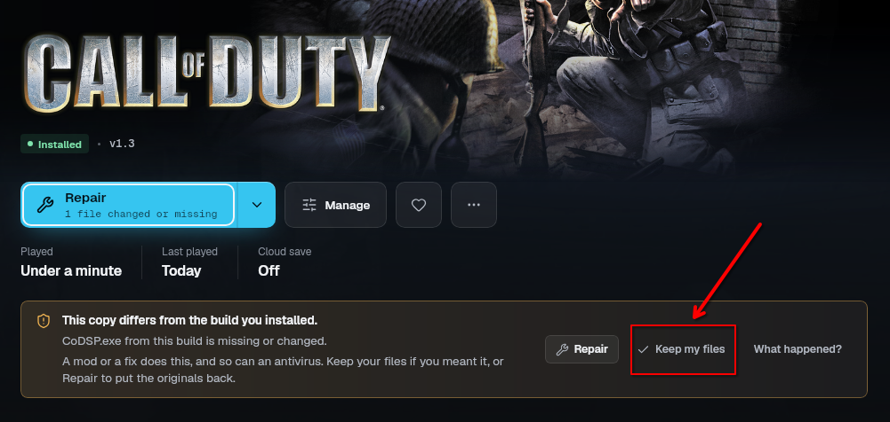

# Call of Duty Coop

Play the **Call of Duty 1 (2003)** campaign, the **United Offensive** expansion and the **Call of Duty 2** campaign in co-op with friends: up to 4 players, through Steam, over the internet by IP, or on a local network.

**[⬇ Download the installer](https://github.com/TheTiranix/CoDCoop/releases/latest)**

## Features

- **The original campaign, together.** One player hosts: the mission runs on their PC, with the game's own AI, scripts and objectives. The others join their game and play it with them.
- **Down, not dead.** If you get killed you go down, and a teammate revives you by holding *Use* for 3 seconds. If everyone goes down, you go back to the last checkpoint.
- **Mission after mission.** When the host moves on to the next level, everyone else follows automatically.
- **Vehicles.** Teammates ride along with the host and can shoot from the vehicle. On tanks they ride on top with an infantry weapon.
- **Nobody gets left behind.** Anyone who stays too far from the host for a few seconds reappears right behind them.
- **Steam or IP.** With Steam there are no ports to open: your friends see you in the menu and join with one click.
- **Drop in, drop out.** If someone disconnects, their slot is freed and they can join again.
- **On screen.** Teammates show up on the compass (not yet in United Offensive), with messages when someone is down or being revived.
- **United Offensive too.** The same install works for the expansion if it is in the same folder: start `CoDUOSP.exe` and use its Co-op menu.
- **Call of Duty 2 too.** Same idea for the Call of Duty 2 campaign: see [Call of Duty 2](#call-of-duty-2) below.
- **Same difficulty as the game.** Friendly fire is off by default and can be turned on in the Co-op menu.
- **No collisions between teammates.** Players can walk through each other, so nobody gets stuck when spawning together.

## Requirements

- **Call of Duty 1 version 1.5** for Windows, on every PC that will play.
- For the expansion: **United Offensive version 1.41**, installed in the same folder.
- For Call of Duty 2: **version 1.3** (`CoD2SP_s.exe`).
- The mod installed on all of those PCs.

## Install

1. Download `Install-CoD-Coop.exe` from the [latest release](https://github.com/TheTiranix/CoDCoop/releases/latest).
2. Run it and accept the game folder (the one with `CoDSP.exe`, or `CoD2SP_s.exe` for Call of Duty 2). If it can't find it, it lets you choose it.
3. If Windows shows "Windows protected your PC", click **More info** → **Run anyway** (the installer is not signed).

The installer copies `ddraw.dll`, `codcoop_core.dll`, `steam_api.dll`, `main\pakz_coop.pk3` and a `CoD Coop README.txt` into the game folder, plus `uo\pakz_coop.pk3` if United Offensive is there. If there was already a `ddraw.dll` or `steam_api.dll` from another program, it keeps it with `.bak` added to the name.

## Linux (Proton / Wine)

The mod is a Windows mod and runs on Linux through Proton. Everything below was
set up and tested on Linux with the **AnkerGames launcher** and Proton 11.0, on an
NVIDIA card and with Mesa/llvmpipe:

1. Install the game and the launcher as usual, get Call of Duty to **1.5**, then
   run the mod installer.
2. When the launcher warns that the files changed, click **Keep my files**:

   

   *Repair* puts the original files back and removes the mod.
3. If the game closes right after the intro with **"Buffer overrun detected!"**,
   that is an old-engine problem with modern GPU drivers, not the mod. Two
   environment variables fix it:

   ```sh
   export __GL_ExtensionStringVersion=15000   # NVIDIA
   export MESA_EXTENSION_MAX_YEAR=2003        # AMD / Intel (Mesa)
   ```

   Under a launcher, put those two lines in a small wrapper around `umu-run` (or
   `proton`) and restart the launcher completely, including its tray icon. The
   same wrapper has to add `WINEDLLOVERRIDES="${WINEDLLOVERRIDES:+$WINEDLLOVERRIDES;}ddraw=n,b"`
   — without it Wine uses its own `ddraw.dll` and the mod is not loaded (no
   *Co-op* entry, no `codcoop.log`). The ready-made wrapper is in
   [docs/linux.md](docs/linux.md), section 1.
4. **Steam overlay / friends list:** Steam only injects its overlay into games it
   launches itself. The wrapper above hands the launch to Steam when `CoDSP.exe`
   exists as a non-Steam game, so starting from AnkerGames still gives you
   Shift+Tab and the friends list. Without that entry the game and the mod still
   work, but the overlay is missing.
5. On the first start Call of Duty may ask whether the hardware changed (the
   launcher's config comes from another PC). Click **Ja** once — the game then
   stores the values it detected and the question does not come back.

Full guide, including the wrapper, the start check the launcher shows and the
Steam prerequisites: **[docs/linux.md](docs/linux.md)**.

**Steam friend invites — prerequisites on every PC** (Windows and Linux):

1. Steam is running and signed in.
2. Spacewar (AppID 480) is installed once — it is free, and both installers offer
   to open it at the end (`steam://install/480`).
3. The game has to see Steam:
   * **Linux:** start the game **through Steam** — *Add a Non-Steam Game* →
     `CoDSP.exe`, then set Proton for that entry. A game started by the launcher
     alone does not see Steam. In the shortcut's *Launch Options* put:

     ```
     WINEDLLOVERRIDES="ddraw=n,b" __GL_ExtensionStringVersion=15000 MESA_EXTENSION_MAX_YEAR=2003 %command%
     ```

     The first part is required: Wine otherwise uses its own `ddraw.dll` and the
     mod is not loaded at all (no *Co-op* entry, no `codcoop.log`). The two
     variables are the OpenGL fix from step 3.
   * **Windows:** starting it normally is enough (also from AnkerGames); the mod
     finds the running Steam by itself.

Without those the mod logs `steam: no disponible ... solo por IP`, and joining by
IP still works (UDP 28960). Host and client only have to match on **Call of Duty
1.5** and the mod version — Windows and Linux can play together.

### Building and installing on Linux

The sources build on Linux with a MinGW cross compiler, and the mod can be
installed without Wine:

```sh
sudo apt install g++-mingw-w64-i686
./build.sh                                                  # the three DLLs
python3 tools/install-linux.py --game "/path/to/Call of Duty"   # from the latest release
python3 tools/install-linux.py --game ".../Call of Duty" --build build   # from ./build.sh
python3 tools/install-linux.py --game ".../Call of Duty" --check         # verify
```

The script insists on Call of Duty **1.5** before touching anything, keeps a
`.bak` of replaced files and also handles a lowercase `main/` folder. Details in
**[docs/linux.md](docs/linux.md)**.

## Play

1. Start Call of Duty as usual and open **Co-op** in the main menu.
2. **Host:** click **Host game** (a green line confirms the port is open) and then pick **New Game** or **Load Game**.
3. **Everyone else:** click **Join <name>** (Steam friends) or type the host's IP and click **Join**.

In the same menu (also during the game, from the pause menu):
- **Friendly fire: Yes/No** is decided by the host.
- **Disconnect** leaves the co-op game: a player who joined goes back to the main menu; if the host clicks it, everyone else goes back to the menu and the host keeps playing alone.

### Through Steam (no ports to open)

- Everyone needs Steam and the game running.
- When the host starts a game, their Steam friends get a **Join <name>** button in the Co-op menu.
- You can also use the Steam friends list: right-click the host → **Join Game** (with the game already running).
- While the game is running, Steam shows "Playing Spacewar": that is expected, co-op uses that Steam test app (AppID 480) to connect.

### Over the internet by IP

- The host opens **UDP port 28960** on their router (forwarded to their PC) and gives the others their public IP.
- On the same home network the host's local IP is enough (`ipconfig`).
- If you can't open ports: use a virtual network program (for example Radmin VPN or ZeroTier) and the IP it gives the host.

### Console commands

| Command | What it does |
|---|---|
| `coophost [port]` | Hosts a game (port 28960 if not given) |
| `coopjoin <ip>[:port]` | Joins the game at that IP |
| `coopjoin steam:<SteamID>` | Joins that player's game through Steam |
| `set coop_friendlyfire 1` | Turns friendly fire on (on the host) |
| `coopleave` | Leaves the co-op game (same as the Disconnect button) |

## Call of Duty 2

The Call of Duty 2 campaign works the same way: the host runs the mission and up to 3 friends join it.

1. Start Call of Duty 2 (single player) and open **Co-op** in the main menu.
2. **Host:** click **Host game**, then start or load a mission as usual (New Game, Mission Select, Resume).
3. **Everyone else:** click **Join <name>** (Steam friends) or type the host's IP and click **Join**. Your game loads the host's mission by itself.

- **Steam:** same as in Call of Duty 1 (no ports to open; Steam shows "Playing Spacewar"). Friends can also join from the Steam friends list (right-click the host → **Join Game**).
- **By IP:** connections use **UDP port 28962** (the host opens it on their router when playing over the internet, or uses a virtual network such as Radmin VPN or ZeroTier).
- Teammates see each other (standing, crouching, prone, with the weapon in hand), shoot, ride the host's vehicles, show up on the compass and revive each other.
- The pause menu does not stop the game while teammates are connected. The **Co-op** window (also from the pause menu) has **Friendly fire** (the host decides) and **Disconnect**.
- Console: `coop2host`, `coop2join <ip>`, `coop2join steam:<SteamID>`, `coop2leave`, `set coop2_friendlyfire 1`.
- Uninstall: delete `ddraw.dll`, `cod2coop.dll`, `steam_api.dll` and `main\zz_coop2.iwd` from the Call of Duty 2 folder (and remove `.bak` from `ddraw.dll.bak` or `steam_api.dll.bak` if there are any).

## Troubleshooting

- **After "Host game" there is no New Game / Load Game / Credits in the menu.**
  That was a menu bug while hosting: update to a current build (see
  [docs/menu-hosting-fix.md](docs/menu-hosting-fix.md)). It is fixed in the menu
  that ships with the installer.
- **Linux / Proton: the game crashes or the launcher wants to repair the install.**
  See [Linux (Proton / Wine)](#linux-proton--wine) above and
  [docs/linux.md](docs/linux.md).
- **Steam is not available, only IP joining.** Without a running Steam inside the
  Proton prefix the mod logs `steam: no disponible ... solo por IP`. IP joining
  still works (UDP 28960).

## Uninstall

Delete `ddraw.dll`, `codcoop_core.dll`, `steam_api.dll`, `main\pakz_coop.pk3`, `uo\pakz_coop.pk3` and the `codcoop_tmp` folder from the game folder. If there are `.bak` files (`ddraw.dll.bak`, `steam_api.dll.bak`), remove the `.bak` from their names.

## How it works

Under the hood, CoD1's single player is a Quake 3 server and client in the same process. The mod replaces `ddraw.dll` to hook into the game: the host runs the real mission and the others connect to its server as clients, over UDP or through the Steam network. Technical notes (in Spanish) are in [notes/ARQUITECTURA.md](notes/ARQUITECTURA.md).

## Building

You need 32-bit MinGW-w64 (i686), Python 3 and the 32-bit `steam_api.dll` from the Steamworks SDK.

1. Put a copy of the game in `game\` (not included in the repo) and set the MinGW and `steam_api.dll` paths in `build.bat`.
2. Run `build.bat`. It builds `build\ddraw.dll`, `build\codcoop_core.dll`, `build\cod2coop.dll`, `game\main\pakz_coop.pk3` and the installer `build\Install CoD Coop.exe`. For Call of Duty 2, put a copy of it in `game2\`: the build also copies the mod there and makes `game2\main\zz_coop2.iwd`.

## License

[MIT](LICENSE). Call of Duty belongs to Activision and `steam_api.dll` belongs to Valve: they are not part of this code.
