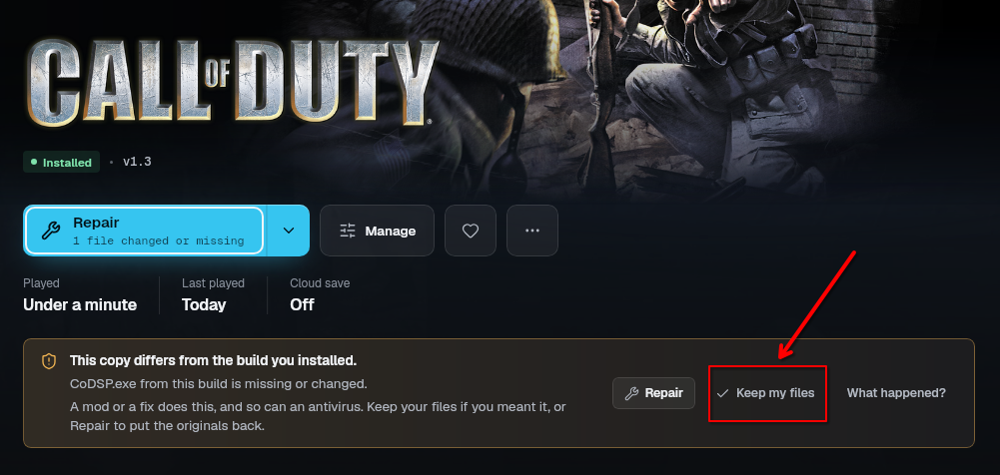
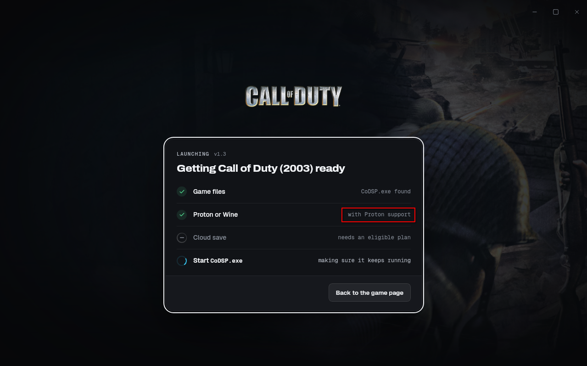

# Running CoD Coop on Linux (Proton / Wine)

The mod is a Windows mod (DLLs loaded by the game) and runs on Linux through
Proton. This guide is the setup that was tested end to end:

| | |
|---|---|
| Launcher | AnkerGames (also applies to similar launchers that start the game through `umu-run`/Proton) |
| Proton | 11.0 |
| GPU / driver | NVIDIA (proprietary) and Mesa (llvmpipe) |
| Game | Call of Duty 1.5, mod 0.5.0 |

Three things matter on Linux: the launcher has to keep the modified files, the
driver must not report more OpenGL extensions than the 2003 engine can hold, and
Steam — if you want the friend list — has to be reachable inside the prefix.

## 1. "Buffer overrun detected!" right after the intro

**Symptom:** the game closes with a Microsoft Visual C++ runtime message:
*"Buffer overrun detected!"* It happens before the main menu, with or without the
mod.

**Cause:** the 2003 engine copies the OpenGL extension string into a fixed-size
buffer of roughly 8.7 KB. Modern drivers report much more than that, the stack gets
corrupted, and the runtime aborts:

| Driver / setting | Length of the extension string |
|---|---|
| NVIDIA, default | 11,703 chars → crash |
| NVIDIA, `__GL_ExtensionStringVersion=15000` | 3,885 chars → OK |
| Mesa, `MESA_EXTENSION_MAX_YEAR=2015` | 8,475 chars → OK |
| Mesa, `MESA_EXTENSION_MAX_YEAR=2020` | 8,987 chars → crash |

**Fix:** tell the driver to report only extensions from the game's era. Only the
two environment variables are needed:

```sh
export __GL_ExtensionStringVersion=15000   # NVIDIA
export MESA_EXTENSION_MAX_YEAR=2003        # Mesa (AMD/Intel)
```

### Making it permanent with Proton

Create a small wrapper that sets the variables only for Call of Duty and then
calls the real `umu-run` (or `proton`). The repository ships it as
[`tools/umu-run`](../tools/umu-run); install it together with the helper that
finds the Steam entry:

```sh
install -Dm755 tools/umu-run ~/.local/bin/umu-run
install -Dm755 tools/steam-shortcut.py ~/.local/bin/cod-coop-steam-id
```

The wrapper does three things:

1. It exports the two OpenGL variables (above) and
   `WINEDLLOVERRIDES="ddraw=n,b"`. The `WINEDLLOVERRIDES` line is what makes the
   mod load at all under a launcher: Wine otherwise uses its own `ddraw.dll` and
   the game starts without the mod (no *Co-op* entry in the menu, no
   `codcoop.log`). Appending to an existing value keeps whatever the launcher or
   Proton already sets for DXVK.
2. If the game is registered as a non-Steam game in Steam, it hands the launch
   over to Steam (`steam://rungameid/…`). That is what makes the Steam overlay
   and the friends list (Shift+Tab) work — Steam only injects its overlay into
   games it launches itself. The wrapper waits until the game exits, so the
   launcher keeps showing it as running.
3. Without a Steam entry it falls back to `umu-run`: the game and the mod work,
   only the overlay/friends list is missing.

Put it in place of the launcher's `umu-run` (back up the original first) and
restart the launcher **completely**, including its tray icon — otherwise the old
process keeps the old environment.

## 2. The launcher says the files changed

After installing the mod (or replacing `CoDSP.exe` with the 1.5 build), launchers
that verify their install show:



That is expected: the mod adds files and the 1.5 update replaces `CoDSP.exe`. Click
**Keep my files**. If you click *Repair* instead, the launcher puts the original
files back and the mod has to be installed again.

## 3. Starting the game from the launcher

Once the launcher accepts the changed files, pressing **Play** shows a short
check. It is fine as long as it finds `CoDSP.exe` and runs it through Proton:



What the lines mean:

| Line | Meaning |
|---|---|
| Game files: `CoDSP.exe` found | The 1.5 executable is in place. |
| Proton or Wine: with Proton support | The game starts through Proton, as it should on Linux. |
| Cloud save: needs an eligible plan | Irrelevant for co-op; local saves work. |
| Start `CoDSP.exe`: making sure it keeps running | The launcher waits for the process; this can take a few seconds. |

If the first start closes immediately, see section 1 (the OpenGL extension fix).

## 4. Steam (friend invites)

Steam invites are the same on Linux and Windows, but three things are required —
on **every** PC, host and client:

1. **Steam is running and signed in.** The mod loads `steamclient.dll` from the
   running client; a Steam that is closed or still at the login screen is not
   enough.
2. **Spacewar (AppID 480) is installed once.** It is Valve's free test app and
   the co-op uses it to talk to Steam (that is why Steam shows "Playing
   Spacewar"). Both installers offer to open it at the end; you can also do it
   yourself: `steam://install/480`.
3. **The game sees Steam.**
   * **Linux (Proton):** Steam only injects `steamclient.dll` and the overlay
     into processes it launched, so the game has to be started **through
     Steam**. Add it once: **Games → Add a Non-Steam Game → Browse →
     `CoDSP.exe`**, then open the shortcut's *Properties → Compatibility* and
     tick **Force the use of a specific Steam Play compatibility tool**
     (Proton). The wrapper from section 1 then uses that entry automatically
     when you press Play in the launcher; you can also start the game directly
     from Steam.
   * **Windows:** starting the game normally (also from AnkerGames or the
     desktop) is enough; the mod finds the running Steam by itself. Checking the
     box *Run this game with Steam* is not needed.

### Launch Options for the Steam entry (Linux)

Right-click the new Steam entry → *Properties* → **Launch Options** and paste:

```
WINEDLLOVERRIDES="ddraw=n,b" __GL_ExtensionStringVersion=15000 MESA_EXTENSION_MAX_YEAR=2003 %command%
```

| Part | Why |
|---|---|
| `WINEDLLOVERRIDES="ddraw=n,b"` | **Required.** The mod is loaded by its own `ddraw.dll` next to `CoDSP.exe`. Wine prefers its built-in `ddraw.dll` unless told otherwise — without this the game starts **without the mod**: no *Co-op* entry in the menu and no `codcoop.log`. |
| `__GL_ExtensionStringVersion=15000` | NVIDIA: keeps the OpenGL extension string short enough for the 2003 engine (section 1). |
| `MESA_EXTENSION_MAX_YEAR=2003` | Mesa (AMD/Intel): the same fix. |
| `%command%` | Steam replaces this with the game. |

**Check that the mod is loaded:** the main menu shows **Co-op** between
*Multiplayer* and *Options*, and `codcoop.log` appears next to `CoDSP.exe`. If
both are missing, the `WINEDLLOVERRIDES` part is missing or misspelt.

The mod writes `codcoop.log` next to `CoDSP.exe`. When Steam is reachable it
says:

```
steam: listo como 'your Steam name' (7656119...)
```

If it says `steam: no disponible ... solo por IP`, one of the three points is
missing. Joining and hosting by IP still work in that case — use **Host IP** in
the Co-op window and open **UDP 28960** (UDP 28962 for Call of Duty 2).

### Friends list / overlay when starting from the launcher

If the game is started by AnkerGames (or any launcher that calls `umu-run`),
Steam shows "Playing Spacewar" but **Shift+Tab does nothing and the friends list
is not available**. That is not a mod bug: Steam only injects its overlay into
processes it launched itself.

The wrapper from section 1 solves it: if `CoDSP.exe` exists as a non-Steam game
in Steam, it hands the launch over to Steam and waits until the game exits. The
prerequisites are the same as above (the non-Steam entry, Proton and the launch
options). Start the game normally from AnkerGames; the wrapper uses the Steam
entry, so the overlay and the friends list work, and AnkerGames keeps showing
the game as running.

If no Steam entry is found, the wrapper falls back to `umu-run`: the game and
the mod work, only the overlay/friends list is missing. Add the entry once and
restart the launcher. `tools/steam-shortcut.py` only reads Steam's
`shortcuts.vdf` to find the existing entry; it does not create one.

Linux ↔ Windows works: the invite goes through Steam, not through the game, so
the two sides can run different operating systems, different launchers and
different copies of the game, as long as both are on **Call of Duty 1.5** with
the **same mod version**.

## 5. "Your computer has changed" on the first start

**Symptom:** before the main menu a small Windows dialog appears. With the
AnkerGames package the title and text are raw tokens
(`WIN_COMPUTER_CHANGE_TITLE`, `WIN_COMPUTER_CHANGE_BODY`) because that package
ships without `Main/localization.txt`; the buttons are **Ja** / **Nein**.

**Cause:** Call of Duty stores the hardware it detected in `Main/config.cfg`
(`sys_cpuMHz`, `sys_sysMB`, `sys_vidMB`) and compares it on every start. A
pre-installed copy can carry values from the machine it was prepared on: in the
AnkerGames install used for testing, `Main/config.cfg` had 1024 MB video memory
while Proton reports 4096 MB. Anything more than 16 MB apart triggers the
prompt. This is the stock game, not the mod: it appears with and without it.

**Fix:** click **Ja** once. The game writes what it just detected and the prompt
is gone for good:

```
seta sys_cpuMHz "2903.97"
seta sys_sysMB "1024"
seta sys_vidMB "4096"
```

If it comes back on every start, `Main/config.cfg` is read-only or two different
launchers report different values for the same install. Pick one way to start the
game (section 4) and answer once more.

The other message that can appear, `WIN_CONFIGURE_UPDATED`, compares
`sys_configSum` with a hash of `configure.csv` (inside `Main/pak0.pk3`).
`tools/install-linux.py` recomputes it. If you copy the game by hand, delete the
`seta sys_configSum` line and the game writes it again.

### After a crash: the "improper quit" prompt

**Symptom:** the next start shows a dialog with the title
`WIN_IMPROPER_QUIT_TITLE` and a body starting with `WIN_IMPROPER_QUIT_BODY`
(raw tokens again, same missing `Main/localization.txt`). The buttons are
**Ja** / **Nein** / **Abbrechen**.

**Cause:** while the game runs it keeps a small marker file `__CoDSP` next to
`CoDSP.exe` and deletes it on a normal exit. If the process was killed — task
manager, `kill`, a crash, a launcher that force-stops the game — the marker
stays behind and Call of Duty assumes the last session ended badly. This is the
stock game, not the mod.

**What to click:**

| Button | Meaning |
| --- | --- |
| **Nein** | Start normally. Use this when the last session was fine and only the process was killed. |
| **Ja** | Start in safe mode: video and sound are reset to safe defaults for this run. Use it if the game no longer reaches the menu. |
| **Abbrechen** | Do not start the game. |

After a normal start the marker is removed again. Deleting `__CoDSP` by hand has
the same effect as **Nein**. Closing the game window normally (or quitting from
the main menu) does not trigger the prompt.

## 6. Building the DLLs on Linux

The sources are plain C++ and only need a MinGW cross compiler — no Wine, no
Visual Studio:

```sh
sudo apt install g++-mingw-w64-i686     # Debian / Ubuntu
# Fedora: sudo dnf install mingw32-gcc-c++      Arch: sudo pacman -S mingw-w64-gcc

./build.sh                 # build/ddraw.dll, build/codcoop_core.dll, build/cod2coop.dll
./build.sh --install       # ... and copy them into game/ (and rebuild the menu pak)
./build.sh --installer     # ... and build "Install CoD Coop.exe" (needs every file in installer/installer.rc)
```

`build.sh` is the same build as `build.bat`: identical flags, identical sources.
The only file that is not in the repository is Valve's 32-bit `steam_api.dll`
(Steam invites); copy it into `build/` from a Windows build or a Steamworks
redistributable. Without it the mod still works over IP.

## 7. Installing without Wine (`tools/install-linux.py`)

The Windows installer only extracts its files, so on Linux you can do the same
with a Python script that needs nothing but `python3`:

```sh
# from the latest GitHub release (downloads Install-CoD-Coop.exe and extracts it)
python3 tools/install-linux.py --game "/path/to/Call of Duty"

# from a local build/ produced by ./build.sh (menu pak taken from game/Main/)
python3 tools/install-linux.py --game ".../Call of Duty" --build build

# only verify an existing installation
python3 tools/install-linux.py --game ".../Call of Duty" --check
```

It checks **Call of Duty 1.5 first** (`CoDSP.exe` must be 1,716,224 bytes) and
stops with the download options if it is not — nothing is written in that case.
Existing files are kept as `<name>.bak`. `--dry-run` shows what would be copied,
`--allow-incomplete` installs anyway (multiplayer-only copies).

## 8. Both sides need the same versions

Host and client must both be on **Call of Duty 1.5** and the **same mod version**.
The game version matters, not how you got there (official patch or a 1.5 build
shipped by your launcher).

The menu patch from this repository only changes the menus, not the network code,
so a client with the original menus can still join.
