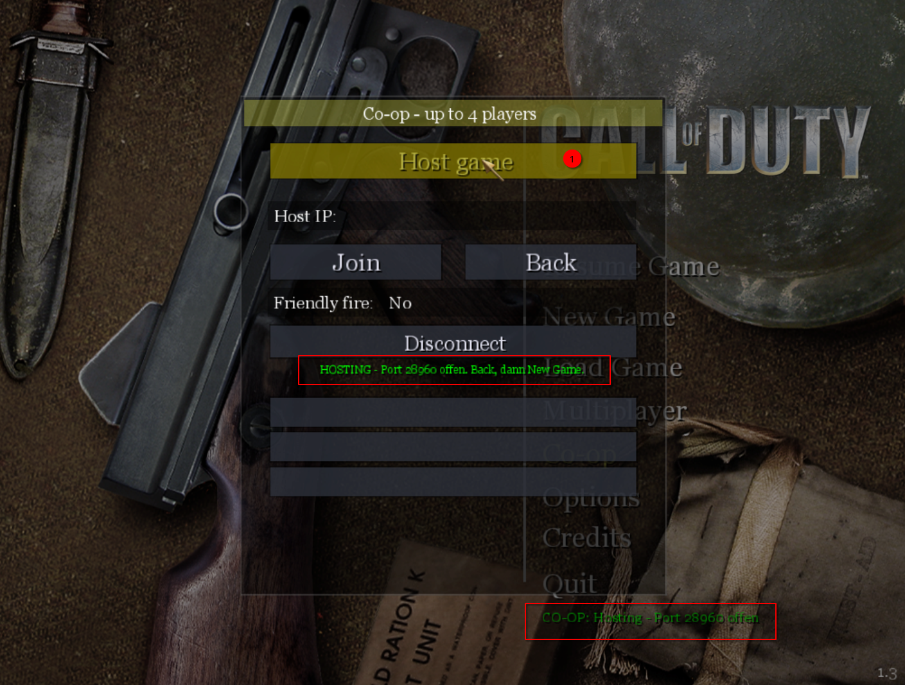

# Menu fix: hosting state (CoD 1)

Two small menu bugs after **Host game**. Both are fixed in `ui/coop_popmenu.menu`,
`ui/coop_button.menu` and `tools/make_ui.py`.

## What was wrong

**1. "Host game" gave no feedback.**
Clicking it only opens UDP 28960. Nothing on screen told you it worked, so it was
easy to click it twice or think it failed.

**2. After "Host game" → "Back", New Game / Load Game / Credits were gone.**

The game uses one variable to know what the menu should show: `ui_coop_paused`.

| Value | Meaning |
|---|---|
| `0` | Main menu, no game |
| `1` | In game (pause menu) |
| **`2`** | **Hosting, no mission loaded yet** |

The menu items are bound to that value, but only `0` and `1` were handled:

| Item | Original rule |
|---|---|
| New Game, Load Game, Credits, Training, Resume | `showCVar { "0" }` |
| Back To Game, Save/Load, Restart | `showCVar { "1" }` |

With `ui_coop_paused = 2` **no** rule matches, so all of them disappear. That is
the "menu is missing New Game" report.

## What the fix does

1. **Feedback.** The Host button also sets `ui_coop_hosting 1`, and a green line
   appears in the Co-op window and in the main menu while hosting:

   

2. **No dead end.** The main-menu items change from *"show only with 0"* to
   *"hide only in game (1)"*:

   ```
   showCVar { "0" }   ->   hideCvar { "1" }
   ```

   They are now visible with `0`, `2` and anything else, and hidden only while a
   mission is running.

## Why not `showCVar { "0" "2" }`?

Because the engine only reads the first value of the list. Tested: the menu stayed
empty. `hideCvar { "1" }` is the only form that works for "visible in more than one
state".

## Files changed

| File | Change |
|---|---|
| `ui/coop_popmenu.menu` | Host button sets `ui_coop_hosting` (Disconnect clears it); green "HOSTING" line in the window |
| `ui/coop_button.menu` | Green "CO-OP: hosting" line in the main menu |
| `tools/make_ui.py` | rewrites `showCVar { "0" }` → `hideCvar { "1" }` while building `ui/main.menu` |

The keywords are written inconsistently in the base game menu (`cvarTest`/`showCVar`
capitalised, but `cvartest`/`showCvar` lowercase for Credits and the Quit
confirmation). The rewrite is therefore case-insensitive — otherwise Credits stays
hidden while hosting.

## Tested

Built with `python -I tools/make_ui.py` and started the game (CoD 1.5):

| State | Result |
|---|---|
| `0` (menu) | New Game, Load Game, Multiplayer, Co-op, Options, Credits, Quit |
| `1` (in game) | Back To Game, New Game, Save/Load Game, … (unchanged) |
| `2` (hosting) | **all of the above again**, including New Game and Credits |
| after Host game | green line appears and disappears again after leaving |

Hosting plus a mission also works: `+coophost +spmap training` opens UDP 28960 and
the mission loads normally.

## Rebuilding

```
python -I tools/make_ui.py
```

It reads `ui/main.menu` from the game's localization pak in `game/Main/` and writes
`game/Main/pakz_coop.pk3`.
